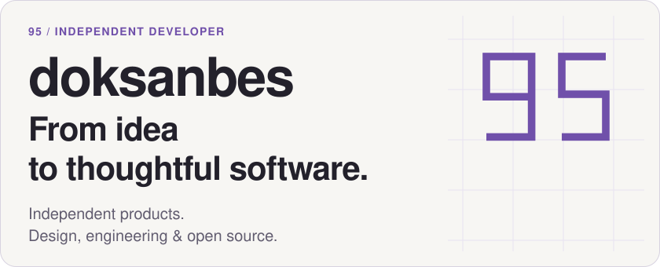
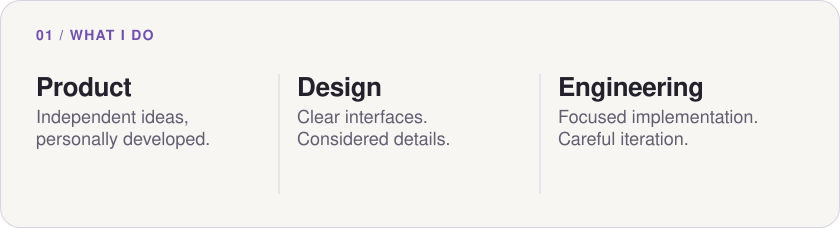
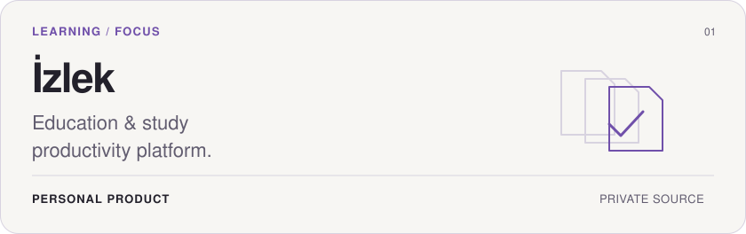
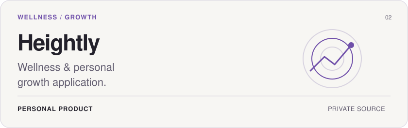
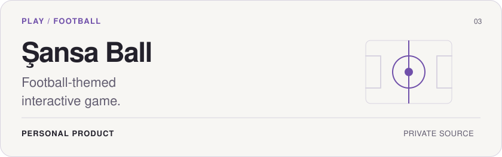
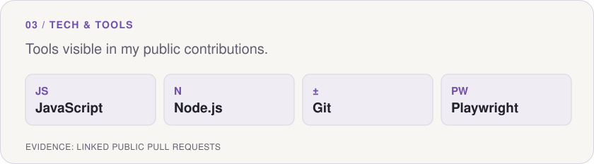
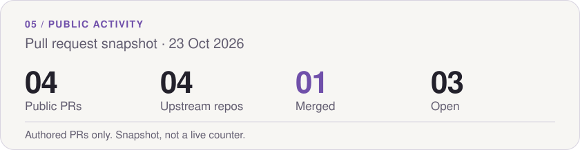
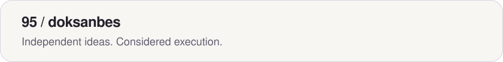

<picture>
  <source media="(max-width: 600px) and (prefers-color-scheme: dark)" srcset="assets/hero-dark-mobile.svg">
  <source media="(max-width: 600px) and (prefers-color-scheme: light)" srcset="assets/hero-light-mobile.svg">
  <source media="(prefers-color-scheme: dark)" srcset="assets/hero-dark.svg">
  <source media="(prefers-color-scheme: light)" srcset="assets/hero-light.svg">
  
</picture>

  <a href="#selected-products">Products</a> · <a href="#tech--tools">Tech &amp; tools</a> · <a href="#open-source">Open source</a> · <a href="#github-activity">Activity</a>

<picture>
  <source media="(max-width: 600px) and (prefers-color-scheme: dark)" srcset="assets/about-dark-mobile.svg">
  <source media="(max-width: 600px) and (prefers-color-scheme: light)" srcset="assets/about-light-mobile.svg">
  <source media="(prefers-color-scheme: dark)" srcset="assets/about-dark.svg">
  <source media="(prefers-color-scheme: light)" srcset="assets/about-light.svg">
  
</picture>

## Selected Products

Three personal products, conceived and developed independently by me. Source code stays private.

<picture>
  <source media="(max-width: 600px) and (prefers-color-scheme: dark)" srcset="assets/izlek-dark-mobile.svg">
  <source media="(max-width: 600px) and (prefers-color-scheme: light)" srcset="assets/izlek-light-mobile.svg">
  <source media="(prefers-color-scheme: dark)" srcset="assets/izlek-dark.svg">
  <source media="(prefers-color-scheme: light)" srcset="assets/izlek-light.svg">
  
</picture>

<picture>
  <source media="(max-width: 600px) and (prefers-color-scheme: dark)" srcset="assets/heightly-dark-mobile.svg">
  <source media="(max-width: 600px) and (prefers-color-scheme: light)" srcset="assets/heightly-light-mobile.svg">
  <source media="(prefers-color-scheme: dark)" srcset="assets/heightly-dark.svg">
  <source media="(prefers-color-scheme: light)" srcset="assets/heightly-light.svg">
  
</picture>

<picture>
  <source media="(max-width: 600px) and (prefers-color-scheme: dark)" srcset="assets/sansa-ball-dark-mobile.svg">
  <source media="(max-width: 600px) and (prefers-color-scheme: light)" srcset="assets/sansa-ball-light-mobile.svg">
  <source media="(prefers-color-scheme: dark)" srcset="assets/sansa-ball-dark.svg">
  <source media="(prefers-color-scheme: light)" srcset="assets/sansa-ball-light.svg">
  
</picture>

## Tech & Tools

<picture>
  <source media="(max-width: 600px) and (prefers-color-scheme: dark)" srcset="assets/tools-dark-mobile.svg">
  <source media="(max-width: 600px) and (prefers-color-scheme: light)" srcset="assets/tools-light-mobile.svg">
  <source media="(prefers-color-scheme: dark)" srcset="assets/tools-dark.svg">
  <source media="(prefers-color-scheme: light)" srcset="assets/tools-light.svg">
  
</picture>

The stack above is evidenced by the JavaScript changes, Node.js regression tests, Git checks and Playwright tests in the public PRs below.

## Open Source

**Merged**

- [ringi-gate #16 ↗](https://github.com/kxmskx/ringi-gate/pull/16) — Correct diagnostic reporting for a missing profile.

**Open pull requests**

- [regex-explain-test #4 ↗](https://github.com/aamirtechs/regex-explain-test/pull/4) — Clarify alternation precedence in regex groups.
- [smarterheads-flow-sandbox #4 ↗](https://github.com/webdeb/smarterheads-flow-sandbox/pull/4) — Fix German transliteration and slug separators.
- [Sitenalyzer #48 ↗](https://github.com/DepressionCenter/Sitenalyzer/pull/48) — Improve clipboard fallback and copy feedback.

Statuses verified on October 23, 2026. Previously on GitHub as isayesh.

## GitHub Activity

<a href="https://github.com/pulls?q=is%3Apr+author%3Adoksanbes">
<picture>
  <source media="(max-width: 600px) and (prefers-color-scheme: dark)" srcset="assets/activity-dark-mobile.svg">
  <source media="(max-width: 600px) and (prefers-color-scheme: light)" srcset="assets/activity-light-mobile.svg">
  <source media="(prefers-color-scheme: dark)" srcset="assets/activity-dark.svg">
  <source media="(prefers-color-scheme: light)" srcset="assets/activity-light.svg">
  
</picture>
</a>

Based on the four public PRs linked above. This dated snapshot updates with this README; it does not include private activity.

<a href="https://github.com/doksanbes?tab=repositories">
<picture>
  <source media="(max-width: 600px) and (prefers-color-scheme: dark)" srcset="assets/footer-dark-mobile.svg">
  <source media="(max-width: 600px) and (prefers-color-scheme: light)" srcset="assets/footer-light-mobile.svg">
  <source media="(prefers-color-scheme: dark)" srcset="assets/footer-dark.svg">
  <source media="(prefers-color-scheme: light)" srcset="assets/footer-light.svg">
  
</picture>
</a>

