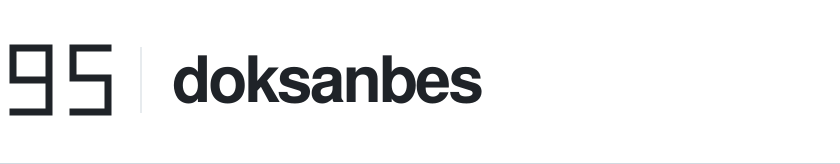

<picture>
  <source media="(prefers-color-scheme: dark)" srcset="assets/wordmark-dark.svg">
  <source media="(prefers-color-scheme: light)" srcset="assets/wordmark-light.svg">
  
</picture>

# Thoughtful software. Built with intent.

Independent developer building personal products and contributing to open source.

 

## Selected products

Conceived and developed independently by me. Source code remains private.

### İzlek

Education & study productivity platform.

### Heightly

Wellness & personal growth application.

### Şansa Ball

Football-themed interactive game.

 

## Open source

Small, focused improvements to tools beyond my own.

**Merged**

- [ringi-gate · #16](https://github.com/kxmskx/ringi-gate/pull/16) — Correct diagnostic reporting for a missing profile.

**Open pull requests**

- [regex-explain-test · #4](https://github.com/aamirtechs/regex-explain-test/pull/4) — Clarify alternation precedence in regex groups.
- [smarterheads-flow-sandbox · #4](https://github.com/webdeb/smarterheads-flow-sandbox/pull/4) — Fix German transliteration and slug separators.
- [Sitenalyzer · #48](https://github.com/DepressionCenter/Sitenalyzer/pull/48) — Improve clipboard fallback and copy feedback.

PR statuses verified on October 23, 2026. Previously on GitHub as isayesh.

 

---

[Explore my public work ↗](https://github.com/doksanbes?tab=repositories)
